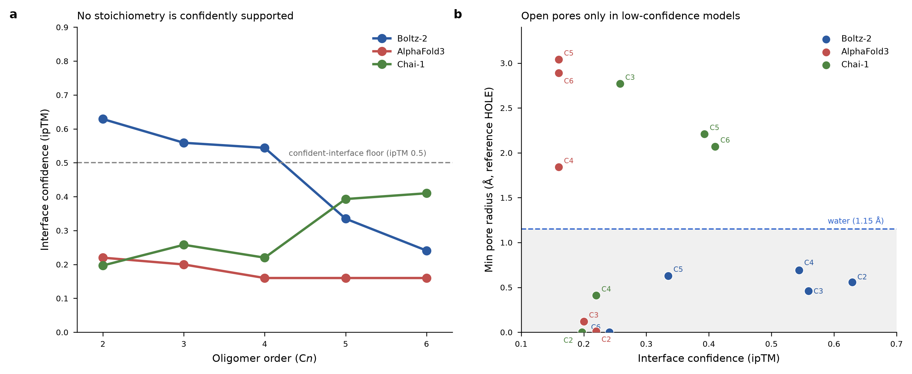
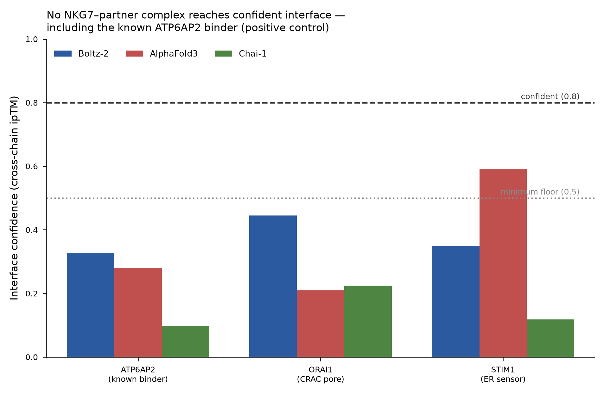

# NKG7 structural analysis: is NKG7 an ion channel?

[](https://github.com/Eomesodermin/nkg7-structural-analysis/actions/workflows/ci.yml)
[](LICENSE)

An in-silico test of whether **NKG7**, a four-transmembrane granule protein of cytotoxic
lymphocytes (NK and CD8⁺ T cells), forms an ion channel. The work combines structural-homology
search, three independent structure predictors (AlphaFold3, Boltz-2, Chai-1) and
reference-HOLE pore analysis, run as a tiered campaign where each stage gates the next.

## Question

NKG7 has no documented channel activity, yet loss of NKG7 reduces Ca²⁺ influx in CD8⁺ T cells,
and its fold resembles the Ca_V-γ (CACNG) auxiliary subunits of calcium channels. Is NKG7 itself
a Ca²⁺-permeable channel, or a channel-family lookalike that acts as a scaffold or auxiliary
modulator? Both readings were fixed before any analysis was run, and every stage tests both.

## Main finding

> NKG7 is a genuine member of the claudin / PMP-22 / Ca_V-γ tetraspan superfamily and it
> self-associates, but it does **not** form a self-contained ion channel. Across three
> independent structure predictors and five oligomeric states, no confident assembly encloses a
> conducting pore. The reproducible self-interface it does form is a lateral TM1–TM1
> helix-packing contact, the hallmark of a scaffold or auxiliary modulator. This matches its
> closest relatives (non-conducting Ca_V/TARP-γ auxiliary subunits and GSG1L) and its known role
> inhibiting the v-ATPase to restrain mTORC1.



**a)** No oligomer order is confidently supported, and the three predictors disagree on the
preferred stoichiometry. **b)** Pore-opening anti-correlates with confidence: every confident
model is occluded (sub-water radius), and the only open pores appear in low-confidence models.

## Approach

Stages run from cheap to expensive, and a negative result stops the next stage. Full rationale
is in [`docs/methods_and_decisions.md`](docs/methods_and_decisions.md).

| Tier | Question | Methods | Outcome |
|------|----------|---------|---------|
| **0. Triage** | What is NKG7? Fold, relatives, transcripts, domains. Does the monomer conduct? | Foldseek, BLAST / Ensembl Compara / phmmer, GTEx, InterProScan, monomer pore scan | **Escalate.** A bona-fide tetraspan, but every analogue is non-conducting and the monomer is occluded (as expected). |
| **1. Oligomer** | Does an oligomer enclose a pore? | Boltz-2, AlphaFold3 and Chai-1 for C2–C6, plus reference HOLE | **Stop the channel track.** Best interface ipTM is 0.63 (confident bar ≈ 0.8); every confident model is occluded. |
| **Pivot: hetero-complex** | What does NKG7 dock onto? | The same three predictors with ATP6AP2, ORAI1 and STIM1 | **Inconclusive.** No confident interface, and the ATP6AP2 positive control also fails, so binary co-folding is under-powered here. |

### Tier 1: two negative criteria that reinforce each other

1. **No confident oligomer.** The best interface confidence anywhere is ipTM 0.63 (Boltz-2
   dimer). The predictors disagree on both stoichiometry and confidence, which is the signature of
   no well-defined assembly.
2. **Pore-opening anti-correlates with confidence.** Every model a predictor is confident about
   is occluded. The only open models are the lowest-confidence ones, with 60–115 Å pore axes:
   splayed aggregates, not a compact ~40 Å transmembrane channel.

Wet-lab context (western-blot multimer bands, NKG7 self-coprecipitation) shows NKG7 does
self-associate, and the predictors corroborate a reproducible dimer interface. But it is a
lateral helix-packing contact, which is why the pore stays shut. Oligomerisation is supported;
pore formation is not.

### Hetero-complex screen



The best cross-chain ipTM is 0.59 (AlphaFold3, STIM1). The ATP6AP2 positive control, a known
binder, scores only 0.10–0.33, so the ORAI1 and STIM1 negatives are *inconclusive*, not evidence
of no interaction. Suggested follow-up: higher-order co-folds (NKG7 with an ORAI1 hexamer) and
experimental partner discovery (co-IP or proximity-labelling mass spectrometry).

## Data and tools

All inputs are public. Nothing heavy is stored in this repository.

| Resource | Used for |
|----------|----------|
| [UniProt](https://www.uniprot.org) Q16617 (human) and Q99PA5 (mouse) | Target sequences (`targets/`) |
| [AlphaFold DB](https://alphafold.ebi.ac.uk) v6, `AF-Q16617-F1`, `AF-Q99PA5-F1` | Monomer models for Tier 0 |
| [Foldseek](https://search.foldseek.com) against PDB100 and AFDB/SwissProt | Structural neighbours |
| NCBI BLAST, [Ensembl](https://www.ensembl.org) Compara, EBI phmmer and [InterPro](https://www.ebi.ac.uk/interpro/) | Sequence relatives, paralogs, domains |
| [GTEx](https://gtexportal.org) v8 | Tissue expression |
| UniProt O75787 (ATP6AP2), Q96D31 (ORAI1), Q13586 (STIM1) | Hetero-complex partners |
| Boltz-2, AlphaFold3 3.0.1, Chai-1 0.6.1 | Structure prediction |
| MDAnalysis 2.10 + mdahole2 0.5 (reference HOLE) | Pore-radius profiles |

## Assumptions and limitations

- All structures are predictions. No experimental NKG7 structure exists.
- Co-folding models are trained largely on soluble complexes, and ipTM cut-offs (≈0.5 floor,
  ≈0.8 confident) are conventions, not calibrations for membrane homo-oligomers.
- Static models cannot capture gating, so the conclusion rests on low confidence *and*
  occlusion together, not on occlusion alone.
- Chai-1 ran without ESM embeddings (cached ColabFold MSA), which mainly affects per-residue
  accuracy, not interface confidence.
- The Tier-0 monomer scan used a geometric probe-sphere method equivalent to HOLE. All Tier-1
  oligomers were scanned with reference HOLE.
- Results are computational. Channel function is defined electrophysiologically, so a positive
  result would need patch clamp, bilayer reconstitution or Ca²⁺-flux imaging.

## Reproducing the analysis

Structure prediction ran on a SLURM GPU cluster (one A40 per predictor job). Tier 0 uses public
web services. See [`envs/README.md`](envs/README.md) for setup and
[`pipeline/README.md`](pipeline/README.md) for the exact commands and run order.

```bash
conda env create -f environment.yml     # pore-scan environment
conda activate nkg7-structure
python pipeline/tier1/hole_scan.py --models-dir results/tier1_models --out-dir hole_out
```

The scan re-runs reference HOLE on the 15 committed Tier-1 models. It needs the `hole` binary on
`PATH` (or `--hole-exe`), and its output corresponds to
[`reports/data/hole_results.json`](reports/data/hole_results.json). Regenerating the models
themselves needs the three predictors and a GPU.

## Repository layout

```
docs/       methods_and_decisions.md: design, gates and rationale
pipeline/   predictor inputs (tier1/, hetero/) and the HOLE scan and AF3 helper scripts
envs/       environment notes for each tool
targets/    NKG7 human and mouse sequences
reports/    three self-contained HTML reports, plus data/ (every table and figure behind them)
results/    the 15 Tier-1 oligomer models, hetero-complex models and the dimer-interface consensus
```

The three reports (open in any browser) are
[`Tier 0 triage`](reports/nkg7_tier0_triage_report.html),
[`Tier 1 oligomers`](reports/nkg7_tier1_oligomer_report.html) and
[`hetero-complex screen`](reports/nkg7_hetero_complex_report.html).

## Related

[`nkg7-binder-design`](https://github.com/Eomesodermin/nkg7-binder-design) applies a
de-novo mini-binder design pipeline to the extracellular loops of the same target.

## Citation

See [`CITATION.cff`](CITATION.cff). Released under the [MIT License](LICENSE).
